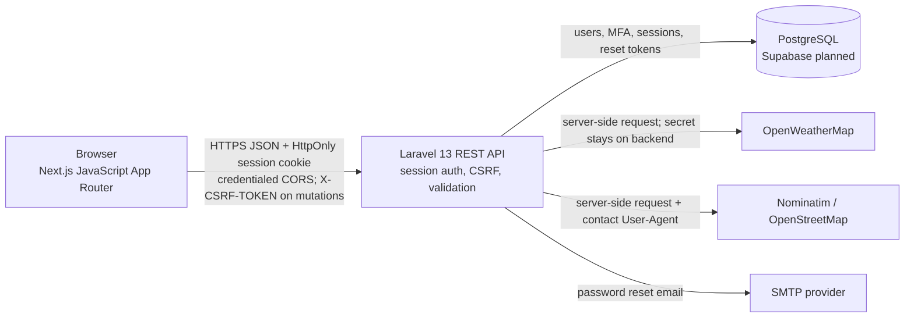

# System Integration Remediation

A student project that connects a Next.js browser app to a Laravel REST API and PostgreSQL. Laravel manages accounts, sessions, MFA, password recovery, and server-side provider requests. The browser never receives database credentials or the weather API key.

## Project status

The application code and automated checks are prepared locally. A localhost browser smoke test verified registration, an authenticated dashboard session, logout, login, and logout again against Laravel. Supabase, SMTP, OpenWeatherMap, production hosting, DNS, and provider-backed browser flows remain unverified because this workspace has no valid service credentials or deployment account configuration. See the final checklist below before presenting or deploying.

## Technology and folders

- `frontend/` — Next.js 16 App Router, React 19, JavaScript, ESLint, Tailwind CSS.
- `backend/` — Laravel 13 API, PHP 8.3+, session authentication, PostgreSQL migrations.
- `docs/` — architecture and Supabase/database notes.
- `.env.example` — points to the separate frontend and backend templates; it is not loaded by either app.

The frontend's original Git metadata is preserved separately at `C:\Users\user\Desktop\System-Integration-Remediation-frontend.git-preserved`. This project is published at [github.com/Tep0t/system-integration-remediation](https://github.com/Tep0t/system-integration-remediation). The separate frontend history was not merged or deleted.

## Architecture



Laravel owns session authentication, authorization, database access, and private provider requests. PostgreSQL/Supabase, SMTP, and provider-backed requests require deployment credentials and have not been verified live. See [docs/architecture.md](docs/architecture.md) and [docs/api.md](docs/api.md) for the request flow, security decisions, and API examples.

## Prerequisites

- Node.js 20.9 or newer and npm.
- PHP 8.3 or newer with `curl`, `fileinfo`, `mbstring`, `openssl`, `pdo_pgsql`, `pgsql`, and `zip`. Enable `pdo_sqlite` and `sqlite3` too if you want to run the test suite using the supplied in-memory SQLite configuration.
- Composer 2.
- A Supabase PostgreSQL database, an SMTP provider, and an OpenWeatherMap API key for testing those external services.
- A contact email to include in the OpenStreetMap Nominatim User-Agent.

The locally verified tools were PHP 8.5.11, Composer 2.10.3, Node 26.8.1, and npm 11.19.0.

For the verified Windows setup, PHP is still in its extracted Downloads folder and was not added to `PATH`:

```powershell
$php = 'C:\Users\user\Downloads\php-8.5.11-nts-Win32-vs17-x64\php.exe'
$ext = 'C:\Users\user\Downloads\php-8.5.11-nts-Win32-vs17-x64\ext'
```

Use these variables when running PHP commands in the current setup. For a different machine, substitute that machine's PHP executable and extension directory.

## Local setup

Keep the frontend and backend on `localhost` (do not mix `localhost` and `127.0.0.1`). This keeps the development origins and session-cookie behavior consistent.

### 1. Configure the frontend

In PowerShell, from the workspace root:

```powershell
Copy-Item frontend\.env.example frontend\.env.local
Set-Location frontend
npm ci
npm run dev
```

Only copy the template when `frontend\.env.local` does not already exist; do not overwrite local settings. The frontend runs at `http://localhost:3000`. Its required setting is:

| Variable | Purpose |
| --- | --- |
| `NEXT_PUBLIC_API_URL` | Laravel API base URL, including `/api`, for example `http://localhost:8000/api`. It must not contain credentials. |
| `NEXT_PUBLIC_APP_NAME` | Display name; optional. |

`NEXT_PUBLIC_` variables are public browser configuration. Never put database passwords, Supabase service-role keys, SMTP passwords, `APP_KEY`, or the weather key in them.

### 2. Configure and run Laravel

Open a second PowerShell window:

```powershell
Set-Location C:\Users\user\Desktop\System-Integration-Remediation\backend
Copy-Item .env.example .env
composer install
```

Copy `.env.example` only if `backend\.env` does not exist. Keep the existing `APP_KEY`; do not generate a new key over an existing one. If a new backend installation has an empty `APP_KEY`, run `php artisan key:generate` once, then keep that key stable.

Set the backend values listed below in the ignored `backend\.env`. The provided local `.env` currently selects SQLite and the log mailer; it does not have Supabase, email, weather, or a Nominatim contact configured. Do not run migrations until the database target and credentials have been checked. For the existing local SQLite configuration, run migrations only after confirming that local database is the intended target:

```powershell
$php = 'C:\Users\user\Downloads\php-8.5.11-nts-Win32-vs17-x64\php.exe'
$ext = 'C:\Users\user\Downloads\php-8.5.11-nts-Win32-vs17-x64\ext'
& $php -d "extension_dir=$ext" -d extension=php_pdo_sqlite.dll -d extension=php_sqlite3.dll artisan migrate
```

For PostgreSQL, enable and verify `pdo_pgsql` in the PHP CLI and run `& $php artisan migrate` only against a confirmed disposable or approved local database. **Do not use `migrate:fresh` against a database with data.**

Start the API in this second window:

```powershell
$php = 'C:\Users\user\Downloads\php-8.5.11-nts-Win32-vs17-x64\php.exe'
$ext = 'C:\Users\user\Downloads\php-8.5.11-nts-Win32-vs17-x64\ext'
& $php -d "extension_dir=$ext" -d extension=php_pdo_sqlite.dll -d extension=php_sqlite3.dll -S localhost:8000 -t public public\index.php
```

The API is then available at `http://localhost:8000/api`. The direct PHP server command loads the SQLite DLLs for this process; this extracted PHP's default CLI configuration does not load them, and `artisan serve` starts a child PHP process that does not inherit process-only extension flags. If SQLite is enabled in PHP's `php.ini`, the usual `php artisan serve --host=localhost --port=8000` command can be used instead. Leave both development servers running in their separate terminals.

### Backend environment variables

| Variable(s) | Purpose |
| --- | --- |
| `APP_ENV`, `APP_DEBUG`, `APP_URL`, `APP_KEY` | Runtime mode, error display, backend URL, and Laravel encryption/signing key. Use `APP_ENV=production`, `APP_DEBUG=false`, HTTPS `APP_URL`, and a stable private key in production. |
| `FRONTEND_URL` | Exact frontend origin allowed by credentialed CORS; for local use `http://localhost:3000`. |
| `TRUSTED_PROXIES` | Comma-separated proxy IPs/CIDRs. Configure only the actual TLS-terminating proxy addresses; leave empty when there is no proxy. |
| `DB_CONNECTION`, `DB_HOST`, `DB_PORT`, `DB_DATABASE`, `DB_USERNAME`, `DB_PASSWORD`, `DB_SCHEMA`, `DB_SSLMODE` | PostgreSQL/Supabase connection. Use values from the Supabase Connect panel and its recommended migration-compatible connection. Keep these only in backend `.env`. |
| `SESSION_DRIVER`, `SESSION_ENCRYPT`, `SESSION_LIFETIME`, `SESSION_DOMAIN`, `SESSION_SECURE_COOKIE`, `SESSION_HTTP_ONLY`, `SESSION_SAME_SITE` | Server-side session and cookie controls. Keep session encryption on. Production encryption, HttpOnly, and Secure are forced. If the frontend and API are on different sites, use HTTPS and `SESSION_SAME_SITE=none`. Keep `SESSION_DOMAIN` unset by default; JSON CSRF-token delivery means a broad shared cookie domain is not required. |
| `CACHE_STORE`, `QUEUE_CONNECTION` | Laravel cache and queue backend. The example uses database-backed services, so their migrations must be applied. |
| `MAIL_MAILER`, `MAIL_HOST`, `MAIL_PORT`, `MAIL_USERNAME`, `MAIL_PASSWORD`, `MAIL_FROM_ADDRESS`, `MAIL_FROM_NAME` | Password-reset email delivery. `MAIL_MAILER=log` is for local development and does not send email. |
| `OPENWEATHERMAP_API_KEY` | Server-only key for weather lookups. Obtain it from OpenWeatherMap; never prefix it with `NEXT_PUBLIC_`. |
| `MAPS_USER_AGENT` | Identifies the app to OpenStreetMap Nominatim and must include a real contact email, for example `SystemIntegrationRemediation/1.0 (contact: you@example.com)`. No browser map key is used. |

There is no Supabase SDK or Supabase browser client in this application: Laravel connects directly to Supabase's PostgreSQL endpoint. Do not add a service-role key to frontend configuration.

The existing local `backend/.env` currently sets `SESSION_ENCRYPT=false`; change it to `true` for local testing as well. Production config forces encrypted sessions, HttpOnly cookies, and Secure cookies regardless of false overrides.

## Features and API routes

The complete endpoint list, request examples, CSRF/session sequence, and response behavior are documented in [docs/api.md](docs/api.md).

| Route | Purpose |
| --- | --- |
| `GET /api/csrf-cookie` | Initialize the Laravel CSRF/session cookies before a state-changing request. |
| `POST /api/register` | Validate and create an account, hash the password, and start a session. |
| `POST /api/login` | Verify password; returns an MFA-pending response for MFA-enabled users instead of authenticating them immediately. |
| `POST /api/mfa/challenge` | Complete a pending login with a TOTP or one-time recovery code. |
| `POST /api/logout`, `GET /api/user` | Invalidate the current session or read the authenticated user. |
| `POST /api/forgot-password`, `POST /api/reset-password` | Request a generic password-recovery response and consume a hashed, expiring reset token. A real mailer is needed to deliver the email. |
| `GET /api/mfa/status`, `POST /api/mfa/setup`, `POST /api/mfa/enable`, `POST /api/mfa/disable` | Configure and manage TOTP MFA; setup and disable require password confirmation, and disabling also requires a second factor. |
| `GET /api/weather?lat=…&lon=…` | Get real weather from OpenWeatherMap using the server-side API key. |
| `POST /api/maps/search` | Search real places through Nominatim; the dashboard embeds an attributed OpenStreetMap view. |

Protected account, MFA management, weather, and map endpoints require a Laravel session. The frontend sends cookies with credentialed requests and fetches the CSRF token from a JSON response on the exact CORS-allowed origin, then sends it in `X-CSRF-TOKEN` for mutations. This avoids requiring JavaScript on a separate Vercel/API hostname to read the API host's XSRF cookie. The session cookie remains HttpOnly and host-only by default; leave `SESSION_DOMAIN` unset unless the actual deployment architecture specifically needs a shared cookie domain. CORS allows only the configured `FRONTEND_URL`.

## Security measures and limitations

- Passwords are hashed; reset tokens are hashed, expiring, throttled, and single-use. Recovery responses do not reveal whether an email is registered.
- MFA uses standard 6-digit TOTP, encrypted at-rest secrets, hashed single-use recovery codes, replay rejection, and throttling. Recovery codes are displayed once; save them securely.
- Session cookies are HttpOnly, sessions are encrypted by default, production cookies are Secure, and production HTTP requests are rejected. When a proxy terminates HTTPS, configure `TRUSTED_PROXIES` narrowly so forwarded HTTPS is trusted only from that proxy.
- Weather keys remain server-side. Nominatim requires a meaningful identifying User-Agent and is globally rate-limited; follow its usage policy and switch providers if intended traffic exceeds its public-service limits. The map includes OpenStreetMap attribution.
- Live Supabase migrations/connectivity, actual SMTP delivery, valid provider keys, and deployed cookie/CORS behavior still require manual configuration and end-to-end testing.
- The frontend dependency audit reported five **high-severity development-tool dependency findings** in the ESLint/Next lint chain. The production-only audit reported zero vulnerabilities. The available npm suggested fix would downgrade `eslint-config-next` to 14.2.35, so it was not applied because that conflicts with the installed Next.js 16 application. Re-check and upgrade the compatible dependency chain before production.

## Tests and checks

Commands used from the relevant folders:

```powershell
# backend: full tests (requires SQLite extensions when using phpunit.xml's in-memory SQLite)
php artisan test

# backend: PHP formatting
vendor\bin\pint --test

# backend: routes and config
php artisan route:list --path=api
php artisan config:show session
php artisan config:show trustedproxy

# frontend
npm run lint
npm run build
npm audit
npm audit --omit=dev
```

In the verified Windows environment, PHP's SQLite modules were not enabled by default. The backend tests were therefore run with PHP's existing SQLite DLLs enabled for that process only:

```powershell
$php = 'C:\Users\user\Downloads\php-8.5.11-nts-Win32-vs17-x64\php.exe'
$ext = 'C:\Users\user\Downloads\php-8.5.11-nts-Win32-vs17-x64\ext'
& $php -d "extension_dir=$ext" -d extension=php_pdo_sqlite.dll -d extension=php_sqlite3.dll vendor\bin\phpunit --testdox
```

Results for this Step 3 validation: **25 backend tests passed (150 assertions); Pint passed; 14 API routes registered; frontend lint passed; production build passed; production-only npm audit reported 0 vulnerabilities.** The full npm audit reported the five high-severity development dependency findings above. A local browser smoke test also registered a disposable user, checked the authenticated dashboard, and completed logout/login/logout; the login form cleared the submitted password and remained enabled after logout. That smoke test used a temporary SQLite database, which was removed afterward. Automated provider tests use fake HTTP responses; no real weather/maps provider, SMTP, Supabase, production deployment, or MFA browser flow was verified.

## Deployment preparation

No deployment has been performed. Vercel access is available, but no Vercel project is linked for this app. A backend hosting provider has not been selected or authenticated. Production secrets, Supabase credentials, domains/DNS, and API provider configuration are not available in this workspace. The GitHub repository is available at [Tep0t/system-integration-remediation](https://github.com/Tep0t/system-integration-remediation).

### Frontend — Vercel

1. Import `https://github.com/Tep0t/system-integration-remediation` and set the Vercel project root to `frontend/`.
2. Add `NEXT_PUBLIC_API_URL=https://<your-api-domain>/api` as a Vercel environment variable for each environment.
3. Deploy only after the API is reachable over HTTPS and configured for the Vercel frontend origin. Do not place private credentials in Vercel browser variables.
4. Rebuild after changing `NEXT_PUBLIC_API_URL`, because Next.js embeds it into the frontend bundle at build time.

### Backend — PHP/Laravel host

1. Choose a host that supports Laravel 13, PHP 8.3+, the required PHP extensions (especially `pdo_pgsql`), Composer, HTTPS, and persistent Laravel session/cache storage.
2. Deploy the `backend/` app with the document root pointed at `backend/public`; install production dependencies with `composer install --no-dev --optimize-autoloader`.
3. Provide production environment variables securely through the host's secret manager: stable `APP_KEY`, `APP_ENV=production`, `APP_DEBUG=false`, HTTPS `APP_URL`, exact Vercel `FRONTEND_URL`, database, mail, weather, maps User-Agent, session/cache/queue settings, and proxy IPs if applicable.
4. Set `SESSION_SECURE_COOKIE=true`. If API and frontend are cross-site, also use `SESSION_SAME_SITE=none`. Keep the session cookie host-only unless a reviewed domain design requires otherwise. Confirm session persistence, HTTPS proxy recognition, JSON CSRF-token delivery, and credentialed CORS with the deployed domains.
5. Configure the host's web process/scheduler/queue only if the chosen provider requires them. Do not expose `.env` or the app's storage directory as public files.

### Database — Supabase PostgreSQL

1. Create/select a Supabase project and use the Supabase Connect panel to choose a connection suitable for Laravel migrations and persistent sessions.
2. Set `DB_CONNECTION=pgsql`, host, port, database, username, password, schema, and TLS mode in the backend host's secret configuration. Ensure PHP's `pdo_pgsql` is enabled.
3. Back up/confirm the target and run `php artisan migrate --force` only against the intended production database during a planned release. Never use `migrate:fresh` on production.
4. Check the resulting schema and run a real login/session flow before launch. This project has not connected to Supabase.

Obtain SMTP credentials and an OpenWeatherMap key from their providers; set the Nominatim contact address in `MAPS_USER_AGENT`. Do not paste secrets into this README, Git, screenshots, or chat.

## Individual demo script

Use a local, disposable database and accounts. Have the API and frontend running as described above.

1. Open the registration page and create a demo user; show the authenticated dashboard and sign out.
2. Sign in again, open dashboard MFA settings, scan the QR with an authenticator app, and enter a current code. Save the recovery codes privately; do not show them on a recording.
3. Sign out and sign in again. Show that password entry pauses at the MFA challenge, then enter a new current authenticator code to reach the dashboard. Do not replay the same TOTP code.
4. On the dashboard, request weather after granting browser location permission, then search for a place and show the attributed OpenStreetMap panel. These steps require a valid weather key and a valid maps User-Agent.
5. Show the forgot-password form. Demonstrate email delivery/reset only if a real SMTP provider and disposable email account have been configured; otherwise state clearly that only the generic API response was tested.
6. Sign out and show that a protected dashboard/API request redirects or returns unauthorized. Do not present fake weather, maps, or provider data.

Explain these code areas during the demo: authentication and CSRF/session endpoints in `backend/app/Http/Controllers/AuthController.php` and `backend/routes/web.php`; MFA enrollment and challenge in `backend/app/Http/Controllers/MfaController.php`; browser API/CSRF handling in `frontend/lib/api.js`; and provider calls in `backend/app/Http/Controllers/WeatherController.php` and `backend/app/Http/Controllers/MapController.php`.

### Troubleshooting and submission evidence

- If a mutation returns `419`, first request `GET /api/csrf-cookie` from the configured frontend origin and retry with the returned `csrf_token` in `X-CSRF-TOKEN` and credentials enabled. Confirm CORS allows that exact origin and credentials.
- If the browser reports a CORS or cookie error, use HTTPS in deployment, check the exact `FRONTEND_URL`, inspect trusted proxy configuration, and set `SESSION_SAME_SITE=none` only for genuinely cross-site HTTPS deployments.
- If `/api/user` returns `401`, the browser session is not authenticated or its cookie is not being sent; log in and inspect cookie scope/HTTPS settings without making the session cookie readable to JavaScript.
- `weather_not_configured` means the backend `OPENWEATHERMAP_API_KEY` is missing or still a placeholder. `weather_unavailable` indicates a provider/network response problem, not valid weather.
- `map_search_not_configured` means `MAPS_USER_AGENT` needs a valid contact email. `map_search_unavailable` indicates a provider/network error. Respect Nominatim's usage limits.
- Password reset will not deliver email with `MAIL_MAILER=log`; configure a real SMTP provider and test with a disposable account.
- For a database connection failure, verify the backend-only PostgreSQL host, port, database, username, password, TLS mode, and `pdo_pgsql`. Do not paste credentials into logs or issue reports.
- Save genuine evidence under a local `evidence/` folder (not credentials, `.env`, reset links, MFA secrets/recovery codes, or session cookies). Suggested captures: registration, authenticated dashboard, MFA challenge (with codes hidden), provider results only when real, and logout/protected-route denial. Record the test date and whether each service was local or deployed. No evidence screenshots have been created for this work.

## Final readiness checklist

- **Complete locally:** Laravel/Next.js code, session/CSRF authentication, password recovery implementation, TOTP MFA and recovery codes, weather/maps server endpoints and UI, security checks, migration definitions, environment templates, documentation, automated test/build/lint checks, and a local registration/login/logout browser smoke test.
- **Partially complete:** GitHub publication, deployment configuration, and demo preparation; the source is published, but no hosting target has been selected or deployed.
- **Blocked pending credentials/account access:** Supabase PostgreSQL connection and production migration, SMTP email delivery, OpenWeatherMap live data, and provider-backed browser testing.
- **Still needs manual verification:** production DNS/HTTPS, trusted proxy addresses, cross-site cookie/CORS behavior on the actual deployment domains, production session/cache setup, recovery email delivery, MFA enrollment/challenge/recovery in a browser, weather/maps with real providers and location permission, review/remediation of high-severity development dependency findings, and end-to-end demo on deployed services. No verified frontend or backend deployment URL is available yet.

Do not deploy or claim live integration until the blocked checks above have been completed.
