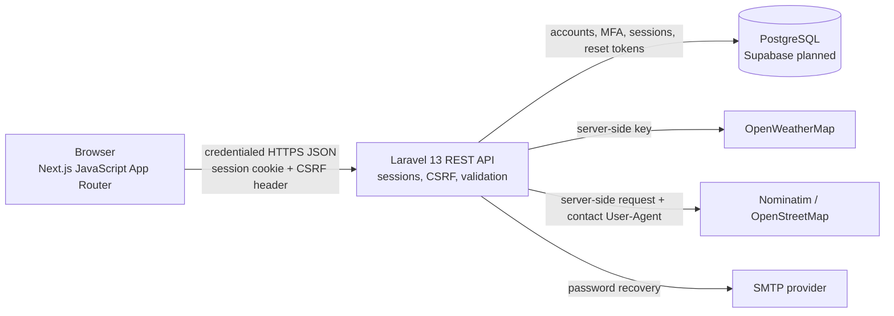

# Project Architecture

## Component diagram

## Request flow

Next.js App Router -> Laravel 13 REST API -> PostgreSQL (Supabase is the planned hosted database)

Laravel owns authentication, validation, password hashing, session management, password recovery, MFA, and database access. It also makes server-side weather and place-search requests. The frontend sends requests with credentials to the API and never receives database credentials or the weather key.

## Authentication and browser security

- Laravel's web session guard uses an HttpOnly session cookie. No bearer token is placed in browser storage.
- Mutating API requests first obtain a CSRF token from Laravel's JSON response and send it in the `X-CSRF-TOKEN` header. This supports separate frontend/API hosts without making the API-host session cookie readable by frontend JavaScript.
- CORS allows only `FRONTEND_URL` and enables credentialed requests. Keep local development on one hostname (`localhost`) for both apps.
- Password reset uses Laravel's database token repository: stored tokens are hashed, expire, are throttled, and are consumed after a successful reset.
- Forgot-password responses are intentionally generic to avoid revealing whether an email is registered.
- TOTP MFA is optional per user. A password-verified challenge must succeed before an MFA-enabled account receives an authenticated session. Recovery codes are one-time use.
- Weather uses a server-side OpenWeatherMap key; maps use Nominatim/OpenStreetMap with attribution and a configured contact User-Agent.

## Environment setup

- Copy `frontend/.env.example` to `frontend/.env.local`; set `NEXT_PUBLIC_API_URL`.
- Keep Laravel's generated `backend/.env` and its `APP_KEY`; use `backend/.env.example` only if `.env` is absent, then set Supabase PostgreSQL values and configure a real SMTP provider.
- Keep the backend `.env` private and never put Supabase database credentials in frontend variables.
- Configure HTTPS, the exact production frontend origin, secure cookies, and explicitly trusted proxy addresses before deployment. Cross-site cookies require `SameSite=None; Secure`.

## Verification status

Automated tests, lint, frontend production build, and a local registration/login/logout browser smoke test are verified locally. The MFA and provider integrations have automated tests but were not exercised in a browser against real services. Live Supabase connectivity, production email, external provider credentials, and deployed cookie/CORS behavior remain unverified until configured and exercised. See [the API reference](api.md) for endpoint and sample-request details.
